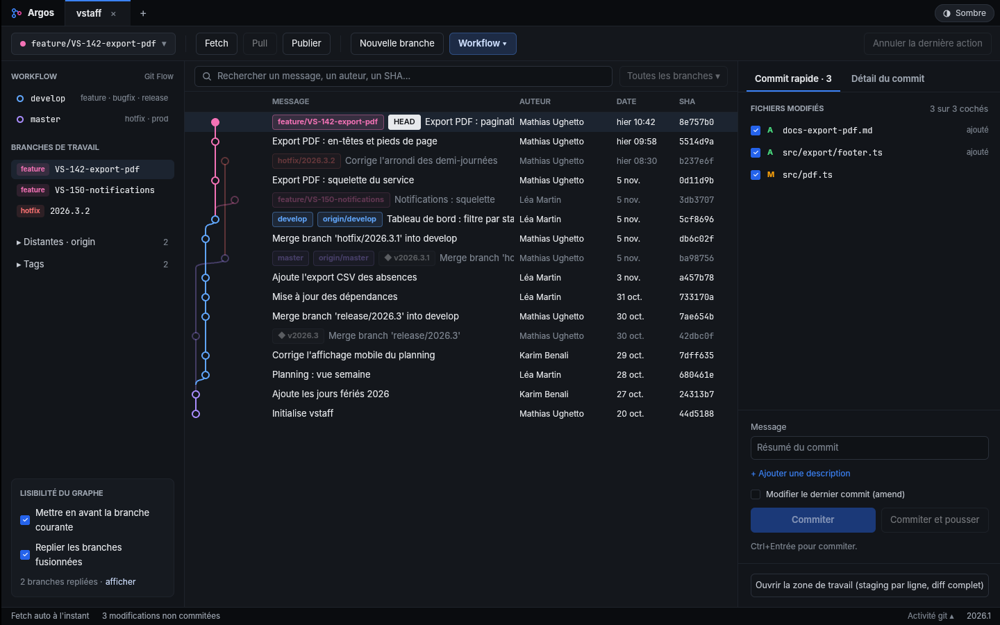
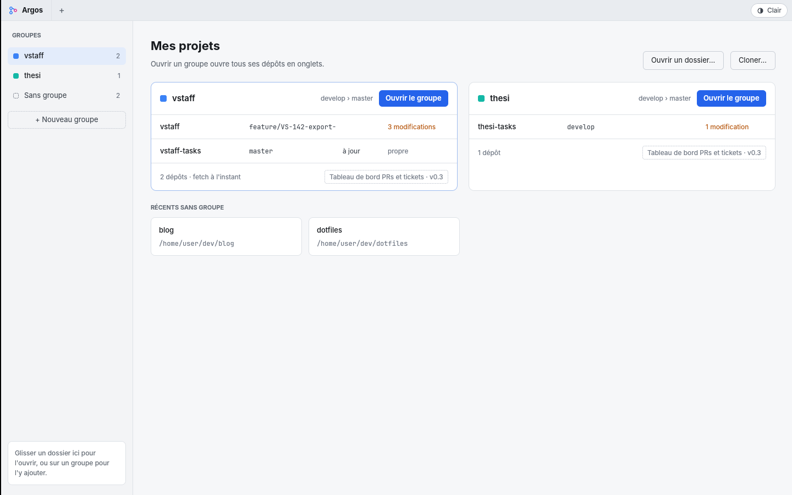
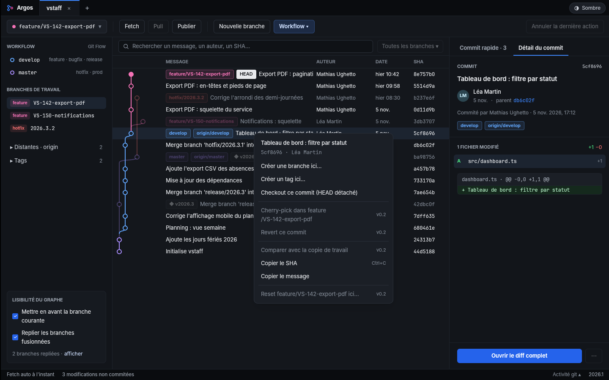

  

<h1 align="center">Argos</h1>

  Un client Git de bureau rapide et léger pour Windows.

  
  

  

## En bref

Argos s'ouvre vite, reste fluide sur les gros dépôts et va à l'essentiel : un graphe lisible, le commit en deux clics et git flow intégré.

- **Un graphe lisible** : chaque branche permanente a sa colonne, la branche courante est mise en avant, et les branches fusionnées puis supprimées sont repliées.
- **Commit rapide** : on coche, on écrit le message, on commite, sans ouvrir de diff. La zone de travail permet de stager bloc par bloc ou ligne par ligne quand c'est utile.
- **Git flow intégré** : démarrer et clôturer une feature, un bugfix, une release ou un hotfix.
- **Tout au clic droit** : branches, tags et commits ont leur menu contextuel. On peut aussi annuler la dernière action.
- **Groupes de projets** : les dépôts qui vont ensemble s'ouvrent ensemble, en onglets.
- **Thèmes clair et sombre.**

  
  

## Installer

1. Téléchargez `Argos-Setup-….exe` depuis la [dernière version](https://github.com/m-ughetto/argos-releases/releases/latest).
2. Lancez-le. L'installation se fait pour votre compte Windows, sans droits administrateur.

Argos se met ensuite à jour tout seul. Quand une nouvelle version est prête, la barre de titre affiche « Redémarrer ». Il faut Windows 10 ou 11 (x64) avec [Git](https://git-scm.com/download/win) installé.

### Stable ou préversions

| Canal | Contenu |
|---|---|
| **Stable** | Les versions publiées depuis `master`, par exemple `2026.1.0` ou `2026.1.1`. |
| **Préversions** | Chaque évolution dès qu'elle est intégrée, par exemple `2026.2.0-beta.3`. Plus fréquentes, moins éprouvées. |

Le canal se choisit en cliquant sur le logo **Argos**, en haut à gauche de la fenêtre.

## À propos

Argos est développé par Mathias Ughetto pour son usage et celui de ses collègues. Le code source est privé, et ce dépôt sert seulement à distribuer les versions.
